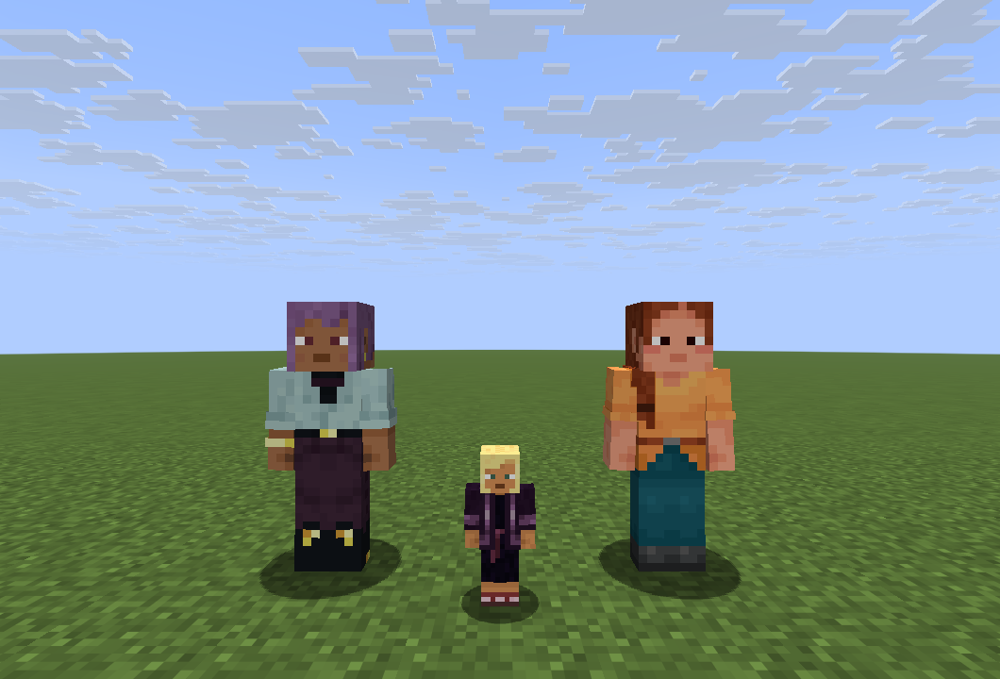

# 随机人形村民 / Random Villager Skins

Minecraft Java **26.2 + Fabric Loader 0.19.3** 客户端外观模组，版本 **1.0.0**，需要 Java 25 和对应版本的 Fabric API。



## 功能

- 普通村民使用人形玩家模型，幼年村民保持较小体型。
- 没有自定义皮肤时，随机使用游戏自带的玩家皮肤，包括 Steve、Alex 等外观。
- 支持普通胳膊与细胳膊模型，以及玩家皮肤的帽子、衣袖、裤腿等外层。
- 按每个村民的 UUID 固定分配皮肤；皮肤列表不变时，重进游戏后保持相同外观。
- 村民仍是原版村民，交易、职业、AI 和存档中的实体数据保持原有行为。
- 可以与同仓库中的冒险零食包同时使用。

## 安装

1. 关闭游戏，在 PCL2 中打开 **26.2 / Fabric 0.19.3** 实例实际使用的游戏文件夹。
2. 将 [模组 JAR](dist/random-villager-skins-1.0.0+mc26.2.jar?raw=true) 放进该实例的 `mods` 文件夹。
3. 安装与 Minecraft 26.2 匹配的 Fabric API；已有对应版本时保留现有文件。
4. 启动游戏，现有村民和新生成的村民都会采用新的外观。

[下载试玩包](随机人形村民-1.0.0-26.2-Fabric试玩包.zip?raw=true)

联机时只需在自己的客户端安装。其他玩家要看到此效果，也需要安装模组；不同客户端使用不同皮肤文件时，看到的外观可能不同。

## 添加自己的玩家皮肤

首次启动后，模组会在该游戏实例中创建：

```text
config/randomvillagerskins/skins/
```

将标准 **64×64 PNG 玩家皮肤**放入这个文件夹：

- 普通胳膊：例如 `steve.png`。
- 细胳膊：文件名以 `_slim.png` 结尾，例如 `alex_slim.png`。
- 每个 PNG 不超过 2 MiB；文件名可以包含中文。

文件夹内有有效 PNG 时，从这些自定义皮肤中随机选择。无有效 PNG 时，使用游戏自带的玩家皮肤；无效文件会跳过并记录在游戏日志中。

添加或修改皮肤后，在游戏聊天栏输入以下客户端指令，或按 **F3+T** 重载资源：

```mcfunction
/villagerskins reload
```

这个客户端指令不需要开启作弊。添加、删除或重命名皮肤会改变皮肤列表，可能重新分配村民外观。

## 开发

本功能通过 Fabric 客户端渲染代码实现。源码位于 `src/main/java`，使用原版玩家模型和皮肤资源，不包含从其他玩家账号下载的素材。

- JDK：25。
- Gradle：9.5.1，已包含 wrapper。
- Fabric Loom：1.17-SNAPSHOT。
- 编译依赖：Fabric API 0.155.2+26.2。

Windows 下设置好 JDK 25 后运行：

```powershell
.\gradlew.bat build
```

成品位于 `build/libs/`。`check` 会运行不依赖 GPU 的皮肤规则检查，覆盖 UUID 保存后分配稳定性、皮肤池分布、PNG 格式与尺寸，以及胳膊模型命名。

资源重载后重建皮肤池，逐个村民渲染时不扫描文件夹。自定义 PNG 仅从本地读取。

## 验证

已通过 Gradle 构建和皮肤规则检查，并在 26.2 Fabric 独立测试世界验证：

- 成年与幼年村民的人形外观，以及普通、细胳膊模型。
- 本地 PNG 皮肤池、无效 PNG 跳过、指令重载后回退到默认皮肤。
- 相同 UUID 的外观在重进世界后保持一致。
- 人形村民可正常打开原版农民交易窗口。

预览图来自实际游戏截图。模组仅注册普通村民的客户端渲染器，不改变流浪商人或僵尸村民。
