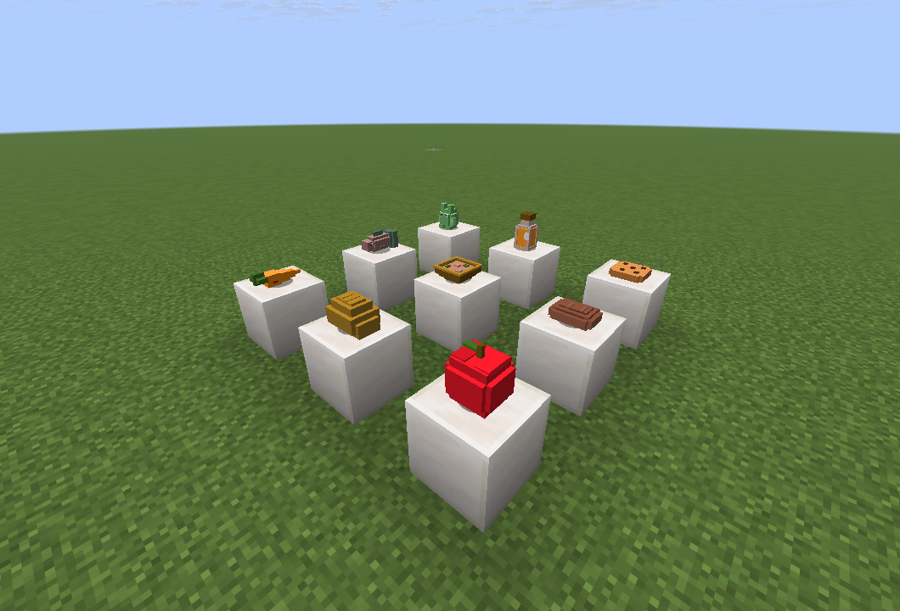
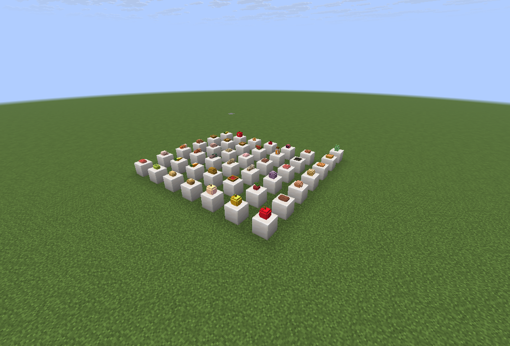

# 立体食物摆盘 / Tabletop Foods

适用 **Minecraft Java 26.2 + Fabric Loader 0.19.3**，需要 **Java 25** 和对应版本 **Fabric API**。模组版本 **1.0.0**。

[GitHub 正式发布页（JAR、试玩包与中文安装说明）](https://github.com/1162990790chu-jpg/github/releases/tag/tabletop-foods-v1.0.0)



## 效果

- 40 种原版可食用物品使用按食物形状制作的立体模型，包括苹果、面包、胡萝卜、鱼、肉、曲奇、汤碗和蜂蜜瓶。
- 支持冒险零食包的加速苹果、夜视胡萝卜、跳跃软糖，共 **43 个定制模型**。
- 手持、物品栏、掉落和摆放状态均能显示立体模型。
- 食物固定摆在方块表面，不旋转、不漂浮、不按掉落物时间自动消失，退出重进后保留。
- 保留物品名称、自定义组件、食物属性和效果数据。

蛋糕保留原版已有的立体方块与摆放、食用行为。其他模组带食物组件的物品也可尝试摆放，但本版本的定制造型范围是原版食物和冒险零食包；其他食物沿用其原模型。

## 操作

| 操作 | 效果 |
| --- | --- |
| 手持食物，右键方块顶面 | 摆放一份，按方块中心对齐 |
| 对准空气长按右键 | 照常吃食物 |
| 空手右键摆放的食物 | 收回背包；背包满则掉在玩家身边 |
| 击打摆放的食物 | 掉落一份，可捡回 |
| 破坏支撑方块 | 食物掉下，可捡回 |
| 潜行右键箱子等交互方块的顶面 | 在其上摆食物，普通右键保留原交互 |
| 潜行右键适合种植的表面 | 胡萝卜、土豆和浆果等仍按原版方式种植 |

生存模式摆放成功才扣除一个物品，创造模式不扣除。支持完整方块及有实体顶面的半砖等表面；一个位置摆一份，已有食物时不重叠摆放。胡萝卜、土豆、甜浆果等可种植食物在顶面普通右键时会摆成食物，潜行右键适合的表面仍可种植。

## 安装

[下载试玩包](立体食物摆盘-1.0.0-26.2-Fabric试玩包.zip?raw=true)

1. 关闭 Minecraft，在 PCL2 打开 **26.2 / Fabric 0.19.3** 实例实际使用的游戏文件夹。
2. 将 [模组 JAR](dist/tabletop-foods-1.0.0+mc26.2.jar?raw=true) 放进 `mods`。
3. 保留或安装对应 Minecraft 26.2 的 Fabric API，再启动游戏。

可以与本仓库中的冒险零食包和随机人形村民一起安装。冒险零食包不是必需依赖。

此模组新增保存于世界中的食物实体，**联机时服务器和各客户端都需要安装**。卸载前请先收回摆放的食物，避免对应实体数据在缺少模组时被游戏移除。

## 源码与构建

使用 Fabric Java 代码和原生模型 JSON，不依赖在线素材或纹理下载，也不修改其他模组源码。模型引用现有游戏纹理，模型资源已随源码提交，普通构建不需要重新生成模型。

设置 JDK 25 后运行：

```powershell
.\gradlew.bat build
```

`check` 会验证模型清单覆盖当前 Minecraft 的所有 `Foods` 定义、三个零食包物品、模型几何、引用和 26.2 图集一致性。

重新生成模型可使用 JDK 自带的源文件运行功能：

```powershell
java '-Djava.awt.headless=true' tools/GenerateFoodModels.java '<minecraft-client.jar 的路径>' src/main/resources
```

`src/devtest` 是独立的开发测试模组，只用于 `runClient`，不会进入成品或源码 JAR。开发存档内 `/tabletoptest run` 执行数量与持久化检查，`/tabletoptest gallery` 生成全部食物展台，`/tabletoptest preview` 生成九种食物展台，`/tabletoptest status` 验证已保存实体身份。

## 实机验证

已通过模型覆盖与引用检查，并在独立的 26.2 Fabric 测试世界通过 **66 项运行检查**，包含原版食物识别、普通方块与蛋糕放置、生存和创造数量、完整组件保存、重复收回、支撑丢失、半砖高度、箱子交互、潜行种植与容器返还。

实际鼠标右键验证了 3 个苹果摆放后剩 2 个，空手收回后恢复 3 个。完整退出客户端、重新进入世界后，43 份展台食物保留相同实体 UUID 和物品身份。


